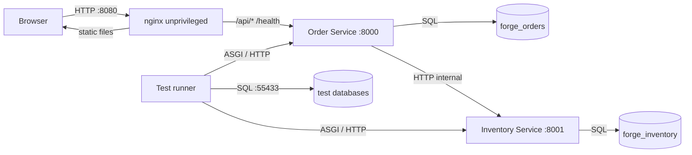
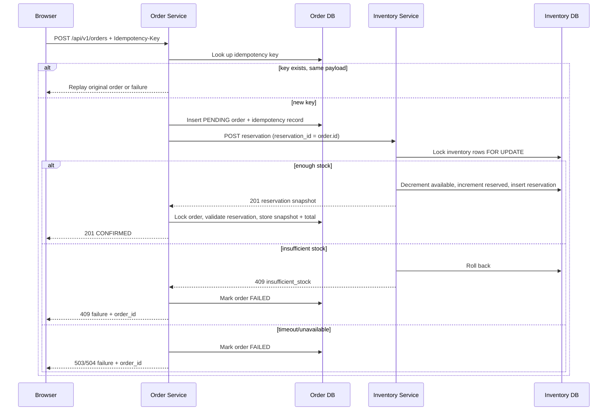
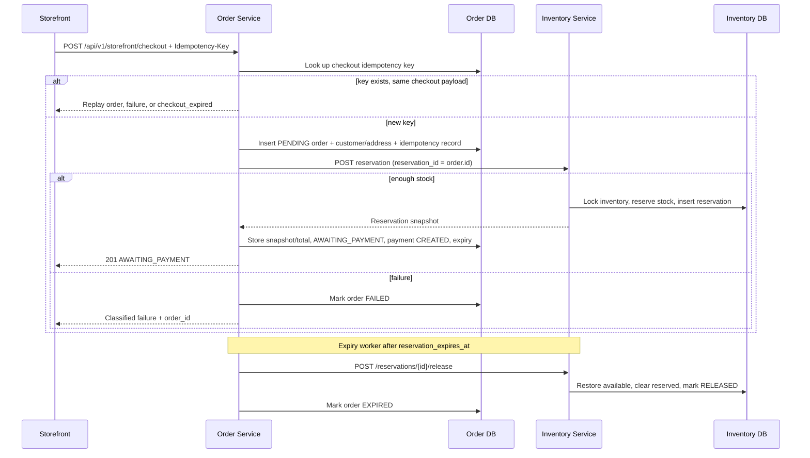

# Architecture

## Goals

Forge Commerce is a local workload for practicing DevSecOps end to end. The design favors:

- A real browser-facing application, not a synthetic demo endpoint.
- Exactly two backend microservices with a clear ownership boundary.
- Synchronous inventory reservation with explicit failure behavior.
- Local reproducibility on Apple Silicon without cloud accounts.
- Automated tests that exercise concurrency and cross-service behavior.
- Container images and runtime settings that can later be scanned, signed, and deployed by a pipeline.

It is not designed for production scale, multi-region deployment, or untrusted public exposure.

## System Context

Published host ports:

- `127.0.0.1:8080` — frontend/nginx
- `127.0.0.1:8000` — Order Service direct API and metrics
- `127.0.0.1:55433` — test PostgreSQL only, behind the `test` profile

Not published:

- Inventory Service `8001`
- Application PostgreSQL `5432`

## Service Responsibilities

### Frontend

- React SPA with a customer storefront and an operations console.
- Storefront: catalog, product detail, persistent cart, checkout, and order confirmation.
- Operations: dashboard, order list, order detail, new-order form, and inventory view.
- Talks only to same-origin `/api/v1/*` and `/health`.
- Displays `PENDING`, `AWAITING_PAYMENT`, `CONFIRMED`, `EXPIRED`, and `FAILED` states, plus `payment_status` and `channel`.
- Keeps an `Idempotency-Key` stable across retries of the same checkout or order form submission.
- Persists the cart in browser local storage only; the Order Service is authoritative for prices, stock, and orders.

### Order Service

Owns:

- Order records, order items, customer/address snapshots, and commercial totals.
- Separate order status, payment status, and sales channel.
- Idempotency records for operations orders and storefront checkout.
- The public API surface consumed by the browser.
- The product catalog proxy to the Inventory Service.
- The order workflow and its failure classification.
- Checkout reservation expiry and the background release worker.
- Order metrics and request context.

Does not own:

- Product stock.
- Reservation records.
- Inventory pricing data beyond the confirmed snapshot.

### Inventory Service

Owns:

- Products and their active state.
- Available and reserved quantities.
- Reservation records and reservation line snapshots.
- Atomic stock reservation and idempotent reservation release.
- The internal product creation endpoint used for seeding/testing.

Does not own:

- Customer details.
- Order lifecycle.
- Public API exposure.

### PostgreSQL

Two logical databases on one local cluster:

- `forge_orders` owned by `forge_order`
- `forge_inventory` owned by `forge_inventory`

There are no cross-database foreign keys. The services integrate over HTTP, preserving service ownership. Test databases `forge_orders_test` and `forge_inventory_test` are owned by the PostgreSQL bootstrap user for test setup and teardown.

## Data Model

### Order database

`orders`

- UUID primary key.
- `status` in `PENDING`, `AWAITING_PAYMENT`, `CONFIRMED`, `EXPIRED`, `FAILED`.
- `payment_status` in `CREATED`/`PENDING`/`FAILED`/`PAID`/`REFUNDED`, nullable until a payment step exists.
- `channel` in `OPS`/`STOREFRONT`.
- Customer name/email and delivery-address snapshots.
- Currency, nullable total, nullable failure code/message.
- `reservation_expires_at` for storefront checkout holds.
- Created/updated timestamps.
- Indexes for status/created time, created time, and reservation expiry.
- Checks for valid status, payment status, channel, and non-negative total.

`order_items`

- UUID primary key.
- FK to `orders` with cascade delete.
- `product_id` is an external identifier, not a cross-database FK.
- Quantity is positive.
- SKU, product name, unit price, currency, and line total are nullable while pending.
- Unique `(order_id, product_id)` and non-negative price check.

`idempotency_records`

- Client key is the primary key.
- SHA-256 request fingerprint.
- Unique FK to the order.
- Created timestamp.

### Inventory database

`products`

- UUID primary key.
- Unique SKU, name, description, price, currency, active flag.
- Created timestamp.

`inventory`

- One row per product, primary key/FK `product_id`.
- `quantity_available` and `quantity_reserved`.
- Check constraints keep both non-negative.

`inventory_reservations`

- Reservation UUID supplied by the Order Service (equal to the order ID).
- Request fingerprint.
- Status (`RESERVED` or `RELEASED`).
- `released_at`, nullable until release.
- Created timestamp.

`inventory_reservation_items`

- FK to reservation and product.
- Quantity, unit price, currency snapshot.
- Unique reservation/product pair.

## Order Creation Workflow

The frontend does not create orders directly against the Inventory Service. The Order Service always initiates reservation with the order UUID, which provides a natural idempotency key across the boundary.

## Storefront Checkout Workflow

The storefront checkout API is separate from the operations order API. Operations orders still become `CONFIRMED` without payment. Storefront orders stop at `AWAITING_PAYMENT`; payment collection is Phase 2.

## Idempotency and Concurrency

### Order creation

- `Idempotency-Key` is required and validated by FastAPI.
- The request payload is canonicalized: items sorted by product ID, JSON sorted keys, compact separators, SHA-256 hash.
- Same key + same fingerprint:
  - `CONFIRMED` or `AWAITING_PAYMENT` returns the order.
  - `EXPIRED` returns `409 checkout_expired` for storefront checkout.
  - `FAILED` returns the original failure and order ID.
  - `PENDING` returns `409 order_in_progress`/`checkout_in_progress` with `Retry-After: 2`.
- Same key + different fingerprint returns `409 idempotency_conflict`.
- Storefront checkout fingerprints include the customer, delivery address, and items.
- Concurrent first submissions race on the primary key; the loser re-reads the winner and replays it.

### Inventory reservation

- The reservation ID is the order UUID.
- The request fingerprint is canonicalized the same way.
- An existing reservation with the same fingerprint returns `200` with the stored snapshot.
- An existing reservation with a different fingerprint returns `409`.
- Releasing an existing `RELEASED` reservation is idempotent and returns `200`.
- Inventory rows are selected in product-ID order with `SELECT ... FOR UPDATE`.
- Shortages are computed before any mutation. On failure, the transaction rolls back.
- Unique constraints and check constraints provide a final database-level guard.

### Why this is enough for the exercise

The workload demonstrates database-enforced idempotency and row-level concurrency control without introducing a message broker, outbox, or saga framework. The remaining gaps are explicit and documented rather than hidden.

## Failure Semantics

| Condition | Order state | HTTP result | Inventory effect |
| --- | --- | --- | --- |
| New operations order, stock available | `CONFIRMED` | `201` | Stock moved from available to reserved |
| Storefront checkout, stock available | `AWAITING_PAYMENT` | `201` | Stock reserved; expiry recorded |
| Insufficient stock | `FAILED` | `409` | Transaction rolled back |
| Unknown/inactive product | `FAILED` | `422` | Transaction rolled back |
| Inventory timeout | `FAILED` | `504` | Unknown; the reservation may have committed |
| Inventory unavailable | `FAILED` | `503` | No reservation |
| Inventory protocol mismatch | `FAILED` | `502` | Reservation may exist; needs reconciliation |
| Order process crash before finalization | `PENDING` | Client sees network error | Reservation may or may not exist |
| Duplicate request while pending | `PENDING` | `409 order_in_progress`/`checkout_in_progress` | No second reservation |
| Reservation expires | `EXPIRED` | None (background) | Release restores available stock |
| Expiry release fails | `AWAITING_PAYMENT` | None (background retry) | Stock remains reserved until retry |
| Storefront lookup of operations order | unchanged | `404 order_not_found` | No data exposed |

### Timeout ambiguity

A timeout is not proof that the reservation failed. The Inventory Service may have committed before the response was lost. The Order Service marks the order `FAILED` for audit and keeps the checkout expiry. The expiry worker retries release after the TTL; if the reservation exists, stock is restored and the failed order's expiry is cleared. This bounds the ambiguity window without introducing a full outbox/saga framework.

### Pending recovery

Storefront checkouts and failed reservations are reconciled by the expiry worker. A general operations-order reconciler/outbox is still not implemented; a `PENDING` operations order can be inspected by an operator, and the idempotent reservation endpoint can be queried by reservation ID. A production design would add a full outbox and reconciliation job.

## API Boundary and Trust

- Browser → nginx: untrusted input, rate-limited and size-limited at the Order Service.
- nginx → Order Service: trusted internal proxy; forwards client IP and request ID context.
- Order Service → Inventory Service: trusted service-to-service HTTP inside the Compose network.
- Services → databases: role-scoped credentials supplied through environment variables.

The Inventory Service is never published. This is enforced by Compose (`expose` only) rather than by application authentication.

## Security Architecture

See [Security](security.md) for the full control list. Architectural choices relevant here:

- Separate database roles prevent accidental cross-service table access.
- No cross-service database reads.
- Backend containers run as non-root with read-only root filesystems.
- nginx runs as the unprivileged nginx image.
- Same-origin API through nginx avoids browser CORS exposure in the normal path.
- Request body size and per-client rate limits are enforced before route handling.
- Error responses use a stable shape without echoing untrusted input.
- Security headers are set by both the API and nginx.
- Images use pinned dependency versions and multi-stage builds to reduce build tooling in runtime layers.

## Observability

Both services expose:

- `/health` — liveness/metadata.
- `/ready` — database readiness.
- `/metrics` — Prometheus text format.

The Order Service metrics endpoint is available directly on loopback. Inventory metrics remain internal and can be read with `docker compose exec`.

Structured JSON logs include:

- Request ID, method, route template, status, duration.
- Order ID, item count, total, failure code.
- Reservation ID, units, item count.
- Downstream target, operation, outcome, and duration.

Prometheus counters are per-process and reset when a container restarts.

## Test Strategy

| Layer | What it proves |
| --- | --- |
| Inventory service tests | Product CRUD, validation, reservation success/release, idempotent replay, insufficient stock, unknown products, concurrent oversell prevention, duplicate reservation races |
| Order service tests | Validation, idempotency, downstream failure mapping, replay behavior, concurrent duplicate creation, catalog proxy, client protocol handling, storefront checkout/expiry |
| Integration tests | Real Order → Inventory checkout and release, concurrent oversell prevention, failed-order retention, storefront expiry |
| Security tests | Body limit, rate limit, CORS, validation error sanitization, security headers, storefront idempotency/validation |
| Frontend tests | Storefront catalog/cart/checkout/order states, form validation, idempotency header, success navigation, retained failure display, order/inventory rendering |

Backend tests use the dedicated test PostgreSQL on `55433`; they never use the application databases.

## Deliberate Deferrals

Not implemented in this phase:

- Authentication and authorization.
- Payment collection, Razorpay, webhooks, and reconciliation.
- A general outbox/reconciliation job for operations orders.
- TLS termination.
- Multi-replica rate limiting.
- Centralized logs, tracing, or dashboards.
- Backups and disaster recovery.
- CI/CD, image signing, SBOM generation, and vulnerability gates.

These are candidates for the next DevSecOps phases rather than hidden production claims.
